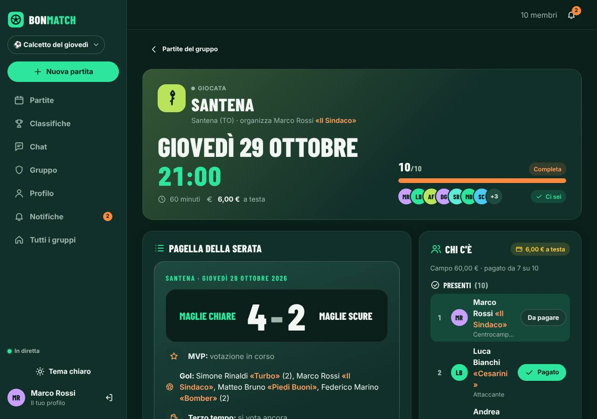

# BONMATCH

Web app privata per **organizzare le partite di calcetto tra amici** e trasformarle nello spogliatoio digitale del gruppo. Si creano gruppi (club con stemma, colori e maglie), si cercano giocatori con le convocazioni **BONCALL**, si raccolgono le iscrizioni con lista d'attesa atomica, si fanno squadre equilibrate dai dati veri (overall della **BONCARD**), si inseriscono risultato e marcatori, si votano MVP, voti, premi e terzo tempo. Partita dopo partita nascono classifiche per stagione, Hall of Fame, traguardi, rivalità, cassa del gruppo e il riepilogo **BONWRAPPED**. Chat e aggiornamenti sono in tempo reale; l'app è installabile (PWA) e può inviare notifiche push.

Il nome è in un'unica costante: `appName` in [`shared/app.config.json`](shared/app.config.json), letto sia dal backend sia dal frontend. Nello stesso file ci sono i quattro campi (Cambiano, Santena, Moncalieri, Villastellone), le opzioni del premio, le reazioni della chat e i valori di default. Per aggiungere un campo basta aggiungere una riga a quella lista (il simbolo si sceglie tra `campanile`, `asparago`, `castello`, `stella`, `pallone`).



## Cosa fa

**Fondamenta (V1)**

- **Account e gruppi:** registrazione, logout reale (token revocato), profilo, gruppi con codice o link d'invito, ruoli admin, soprannomi con storico.
- **Partite:** quattro campi, stati `aperta → chiusa → giocata → archiviata` (più `annullata`), iscrizione "Ci sono / Forse / Non ci sono" con **lista d'attesa atomica**, quota a testa.
- **Dopo la partita:** risultato e marcatori, MVP (un voto, mai a sé stessi, parità condivisa), voti 1-10 anonimi con abilità facoltative, terzo tempo con premiazione, pagella condivisibile.
- **Chat** in tempo reale, **notifiche in-app**, programma periodico (promemoria, chiusura automatica, fine votazioni).

**Novità della V2 «Night League»**

- **Design system NIGHT LEAGUE:** tema scuro e chiaro, mobile-first con barra in basso e pulsante centrale, sidebar su desktop, una sola famiglia di icone (Lucide), animazioni con Motion che rispettano `prefers-reduced-motion`, logo sostituibile in un solo file.
- **Dashboard «Spogliatoio»:** prossima partita con conto alla rovescia, azioni rapide, votazioni da fare, il tuo campionato, posizioni, feed delle attività reali.
- **BONCALL:** convocazioni con data fissa o con alternative da votare, risposte atomiche, conversione idempotente in partita, promemoria senza spam, notifiche in-app, **Web Push** (VAPID, fasce silenziose, limite orario) e **PWA** installabile con pagina offline.
- **BONCARD e BONRATING:** carta del giocatore con overall dichiarato e verificabile, attributi VEL/TIR/PAS/DRI/DIF/FIS solo da valutazioni reali, edizioni con requisiti, esportazione PNG verticale, andamento, forma, record e confronto tra stagioni.
- **MATCHDAY:** locandina, formazioni sul campo, **Bilancia** basato sull'overall (ruoli, portieri, casualità controllata), esportazione verticale e quadrata.
- **Rivalità:** testa a testa e schermata VS, rivalità naturali (da 3 scontri) o dichiarate, nessun testo libero.
- **Stagioni e classifiche:** stagioni annuali, trimestrali, mensili o personalizzate (lo storico non si cancella mai); **12 classifiche** con requisito esplicito e frecce di variazione rispetto alla stagione precedente; **Hall of Fame** con vincitori, record e più premiati.
- **Premi e traguardi:** premi di partita opzionali (bomber automatico, miglior portiere e difensore, sorpresa, premio ironico) e achievement assegnati dal backend, con premiazioni animate disattivabili.
- **Club:** stemma e copertina caricati in sicurezza, colore secondario, motto, maglie chiara e scura, statistiche complessive.
- **Calendario:** vista mese, settimana, prossime e passate, filtro per gruppo, **partite ricorrenti** (annullabili o modificabili una per una), disponibilità, esportazione `.ics`, fuso `Europe/Rome` con ora legale.
- **Cassa:** registro interno di quote, versamenti, spese e rimborsi con stati **dichiarato → verificato → annullato** e storico di ogni passaggio; un pagamento conta solo quando chi lo riceve lo conferma. Nessun denaro passa dall'app.
- **Terzo tempo evoluto:** scadenza visibile, storico, statistiche stagionali, premio più scelto; "chi perde offre" resta facoltativo e senza obblighi.
- **BONWRAPPED:** riepilogo stagionale a schermate condivisibili come PNG, solo con dati reali e con un messaggio quando non bastano.
- **Sicurezza:** rate limiting, rifiuto di chiavi `$`/`.` nelle richieste, upload verificato dai primi byte, permessi su ogni rotta.

## Requisiti

- **Node.js 20 o più recente** (consigliato 22) con npm.
- **MongoDB 6 o 7**: il modo più semplice è Docker Desktop con il `docker-compose.yml` incluso (avvia solo MongoDB).
- Un browser recente. Per i test end-to-end serve Chromium di Playwright (`npx playwright install chromium`).

## Avvio rapido su Windows PowerShell

Servono tre finestre di PowerShell, tutte aperte nella cartella del progetto.

**Finestra 1: MongoDB con Docker**

```powershell
docker compose up -d
```

**Finestra 2: backend** (API su http://localhost:4000/api)

```powershell
cd backend
Copy-Item .env.example .env
npm install
npm run seed
npm run dev
```

**Finestra 3: frontend** (http://localhost:5173)

```powershell
cd frontend
npm install
npm run dev
```

Apri http://localhost:5173 e accedi con `marco@calcetto.test` / `calcetto2026`. Tutti gli account di prova sono elencati più sotto.

> **Senza Docker?** Per una prova veloce puoi usare l'emulatore di sviluppo al posto di MongoDB: nella finestra 1 esegui `cd backend` e poi `npm run db:lite`. I dati restano solo in memoria e si perdono alla chiusura; non è adatto all'uso reale (vedi [docs/DECISIONI.md](docs/DECISIONI.md)).

Su macOS e Linux i comandi sono gli stessi, con `cp .env.example .env` al posto di `Copy-Item`.

## Account di esempio

Il comando `npm run seed` (nella cartella `backend`) crea i dati **solo se mancano**: non cancella mai nulla e rifiuta di partire con `NODE_ENV=production`. Password di tutti gli account: **`calcetto2026`**.

| Email | Nome | Soprannome | Ruolo | Note |
|---|---|---|---|---|
| marco@calcetto.test | Marco Rossi | Il Sindaco | centrocampista | **admin** di "Calcetto del giovedì", membro di "Amici del lunedì" |
| luca@calcetto.test | Luca Bianchi | Cesarini | attaccante | admin di entrambi i gruppi |
| andrea@calcetto.test | Andrea Ferrero | La Saracinesca | portiere | |
| davide@calcetto.test | Davide Gallo | Il Muro | difensore | |
| simone@calcetto.test | Simone Rinaldi | Turbo | attaccante | anche nel gruppo del lunedì |
| matteo@calcetto.test | Matteo Bruno | Piedi Buoni | centrocampista | anche nel gruppo del lunedì |
| stefano@calcetto.test | Stefano Costa | Il Professore | difensore | |
| paolo@calcetto.test | Paolo Ghigo | Gattone | portiere | in lista d'attesa per la partita di Santena |
| federico@calcetto.test | Federico Marino | Bomber | attaccante | anche nel gruppo del lunedì |
| alessandro@calcetto.test | Alessandro Greco | (nessuno) | centrocampista | in lista d'attesa in entrambi i gruppi |

Il seed crea anche 2 gruppi, 11 partite giocate sui quattro campi (con risultati, marcatori, voti, MVP e premi; l'ultima ha le votazioni ancora aperte), 3 partite future (due al completo con lista d'attesa), messaggi di chat con reazioni, soprannomi con storico e qualche notifica. I percorsi di prova guidati sono in [docs/GUIDA_UTILIZZO.md](docs/GUIDA_UTILIZZO.md).

## Variabili d'ambiente

Backend (`backend/.env`, parti da `backend/.env.example`):

| Variabile | Default | Significato |
|---|---|---|
| `NODE_ENV` | `development` | `production` richiede `JWT_SECRET` e blocca il seed |
| `PORT` | `4000` | porta delle API |
| `MONGODB_URI` | `mongodb://127.0.0.1:27017/bonmatch` | database dell'app |
| `MONGODB_URI_TEST` | `mongodb://127.0.0.1:27017/bonmatch_test` | database usato **solo** dai test (il nome deve contenere "test") |
| `JWT_SECRET` | segreto di sviluppo | stringa lunga e casuale, obbligatoria in produzione |
| `JWT_EXPIRES_IN` | `7d` | durata dei token |
| `CLIENT_ORIGIN` | `http://localhost:5173` | origini ammesse da CORS e Socket.IO (separate da virgola) |
| `SCHEDULER_ENABLED` | `true` | promemoria, chiusura automatica, fine votazioni |
| `SCHEDULER_INTERVAL_MS` | `60000` | ogni quanto gira il programma periodico |
| `VAPID_PUBLIC_KEY`, `VAPID_PRIVATE_KEY`, `VAPID_SUBJECT` | vuote | chiavi per le notifiche Web Push (`npm run vapid` le genera); senza chiavi le push sono spente e restano le notifiche in-app |
| `RATE_LIMIT_ENABLED` | `true` | `false` solo nei test automatici |
| `RATE_LIMIT_WINDOW_MS`, `RATE_LIMIT_API_MAX` | `60000`, `600` | richieste per finestra e per IP su tutte le API |
| `RATE_LIMIT_AUTH_WINDOW_MS`, `RATE_LIMIT_LOGIN_MAX`, `RATE_LIMIT_REGISTER_MAX` | `900000`, `20`, `20` | accessi falliti e registrazioni per finestra e per IP |
| `TRUST_PROXY` | assente | numero di proxy fidati (es. `1` dietro nginx) perché i limiti usino l'IP reale |

Frontend (`frontend/.env`, facoltativo): `VITE_BACKEND_URL` (default `http://localhost:4000`), usato dal proxy di Vite per `/api` e `/socket.io`.

Dopo un aggiornamento da una versione precedente esegui `npm run migrate` nella cartella `backend`: è idempotente, ricostruisce il feed, importa i pagamenti già segnati nel registro della cassa e ricalcola i traguardi dallo storico, senza cancellare né sovrascrivere nulla.

## Struttura

```
backend/            API Express, Socket.IO, Mongoose
  src/config/       variabili d'ambiente e configurazione condivisa
  src/models/       modelli Mongoose
  src/routes/       rotte REST
  src/validators/   schemi zod (messaggi in italiano)
  src/middleware/   autenticazione, accesso, errori, rate limiting, sanificazione, upload
  src/controllers/  strato sottile tra rotte e servizi
  src/services/     logica: partite, squadre, votazioni, motore statistico, classifiche,
                    stagioni, premi, traguardi, club, calendario, cassa, terzo tempo, wrapped
  src/utils/        errori, helper, fusi orari, riconoscimento delle immagini
  src/socket/       autenticazione e stanze Socket.IO
  src/jobs/         programma periodico
  src/scripts/      seed e migrazioni (npm run seed / npm run migrate)
  dev/mongo-lite/   emulatore MongoDB per sviluppo e test (non per l'uso reale)
  tests/            test Jest + Supertest
frontend/           React + Vite, CSS con design token
  src/styles/       token, base, componenti, layout, pagine
  src/components/   design system (ui/), icone, logo, BONCARD, partita, club, calendario, wrapped
  src/pages/        schermate
  src/context/      autenticazione, tempo reale, dati dell'app, toast, tema, animazioni
  src/__tests__/    test Vitest + Testing Library
  public/           manifest, icone, service worker, pagina offline, logo
shared/             app.config.json: nome, campi, premi, default
e2e/                test Playwright + axe-core, screenshot
postman/            collection con test sui codici HTTP
docs/               architettura, API, test, decisioni, roadmap, guida d'uso, screenshot
```

## Modelli

Il dettaglio dei campi è in [docs/ARCHITETTURA.md](docs/ARCHITETTURA.md). In sintesi: `User`, `RevokedToken`, `Group` (con identità del club e impostazioni), `Nickname`, `Match` (iscritti con stato del pagamento, squadre, risultato, votazioni, premi, serie), `MvpVote`, `Rating`, `PrizeVote`, `AwardVote` (voti anonimi con indici unici), `Message`, `Notification`, `PushSubscription`, `Activity` (feed), `Poll` (BONCALL), `Rivalry`, `Season`, `Achievement`, `MatchSeries`, `Availability`, `LedgerEntry`.

**Iscrizione atomica.** Il campo `freeSlots` è il contatore dei posti liberi. Un posto si prende con un solo `findOneAndUpdate` che richiede `freeSlots > 0` (e che nessuno sia in lista d'attesa) e lo decrementa nella stessa operazione: due richieste contemporanee per l'ultimo posto non possono riuscire entrambe. Lo stesso modulo (`registration.js`) vale per le convocazioni BONCALL. I test lo verificano con richieste in parallelo.

**Idempotenza.** Quote (`{match, user}`), occorrenze delle ricorrenze (`{series, occurrenceKey}`), traguardi (`{user, group, key}`), voti, conversione di una convocazione in partita e notifiche (`dedupeKey`) hanno indici unici; i passaggi di stato (cassa, chiusura dei premi, MVP) sono aggiornamenti atomici condizionati allo stato di partenza.

## Permessi

Tutti i controlli sono sul server. Chi non è nel gruppo riceve **403** su tutto ciò che riguarda il gruppo, le sue partite, la chat, la cassa e il calendario.

| Azione | Visitatore | Membro | Organizzatore della partita | Admin del gruppo |
|---|:-:|:-:|:-:|:-:|
| Landing, accesso, registrazione | ✓ | ✓ | ✓ | ✓ |
| Creare gruppi, entrare con codice o link | | ✓ | ✓ | ✓ |
| Vedere partite, classifiche, Hall of Fame, club, chat, calendario, terzo tempo, BONWRAPPED | | ✓ | ✓ | ✓ |
| Iscriversi, rispondere alle convocazioni, votare (anche i premi), scrivere in chat, indicare la disponibilità | | ✓ | ✓ | ✓ |
| Dichiarare il proprio pagamento o un versamento, vedere il proprio saldo | | ✓ | ✓ | ✓ |
| Creare partite, convocazioni e ricorrenze | | ✓ se il gruppo lo consente | ✓ | ✓ |
| Modificare la partita, cambiarne lo stato, fare le squadre, inserire il risultato, chiudere le votazioni, assegnare un premio, **confermare** i pagamenti della partita | | | ✓ | ✓ |
| Modificare o fermare una ricorrenza | | solo se l'ha creata | ✓ | ✓ |
| Impostazioni del gruppo, stagioni, club (stemma, copertina, colori), premi attivi, cassa comune, spese e rimborsi, saldi di tutti, ruoli, codice invito, rimuovere soprannomi | | | | ✓ |

Il destinatario di un soprannome è l'unico che può rifiutarlo o sostituirlo. Le email non compaiono mai nelle risposte destinate a chi non è nel gruppo. I voti (MVP, premi, terzo tempo, voti 1-10) sono anonimi: le API mostrano solo i totali e il proprio voto.

## API

Prefisso `/api`, autenticazione con `Authorization: Bearer <token>`, errori nella forma `{ "error": { "code", "message", "fields"? } }` con messaggi in italiano. L'elenco completo delle rotte, con permessi, parametri, limiti di frequenza e formato degli errori, è in **[docs/API.md](docs/API.md)**. La collection [postman/BONMATCH.postman_collection.json](postman/BONMATCH.postman_collection.json) percorre le API della V1.

## Tempo reale

- Ogni azione passa dalle API REST. Solo **dopo** il salvataggio il servizio `realtime` trasmette l'evento: il server resta la fonte di verità.
- Il client Socket.IO si autentica con lo stesso JWT (`auth.token`). Alla connessione entra nella stanza personale `user:<id>` e nelle stanze `group:<id>` dei suoi gruppi; quando entra o esce da un gruppo le stanze si aggiornano subito. Al logout i socket aperti con quel token vengono chiusi.
- Eventi: `match:created`, `match:updated` (presenti e lista d'attesa dal vivo), `voting:updated`, `chat:message`, `chat:reaction`, `group:updated`, `group:removed`, `notification:new`, `activity:new`, `poll:updated`, `cashbox:updated` (solo identificativi).
- In alto c'è l'indicatore "In diretta / Riconnessione / Non in linea". La riconnessione è automatica; quando torna la connessione ogni schermata ricarica i propri dati e la chat chiede i messaggi successivi all'ultimo ricevuto (`?after=`).
- Un programma periodico (ogni minuto) invia i promemoria il giorno prima a chi non ha risposto, chiude le iscrizioni all'orario d'inizio e chiude le votazioni scadute. Le votazioni scadute si chiudono anche quando qualcuno apre la partita.

## Come sono calcolate le classifiche

Contano solo le partite giocate (`giocata` o `archiviata`) con risultato, nel periodo scelto: **sempre**, **questo mese**, la **stagione corrente** del gruppo o una **stagione passata**. Per comparire serve il numero minimo di partite del gruppo (default 3). A parità di valore la posizione è condivisa. Ogni voce mostra la variazione rispetto alla stagione precedente; ogni classifica dichiara il proprio requisito e, se nessuno lo soddisfa, risulta "non disponibile" con il motivo.

| Classifica | Calcolo | Requisito |
|---|---|---|
| I più forti | media voti 1-10 + 2 × (MVP ÷ partite); senza voti si parte da 5 | minimo partite |
| MVP | volte eletto MVP (condiviso = uno a testa) | almeno un MVP |
| I più vincenti | partite vinte ÷ giocate | minimo partite |
| Il club di chi non vince mai | percentuale di vittorie più bassa; a pari merito sale chi ha più sconfitte di un gol | almeno 5 partite |
| I più presenti | giocate ÷ partite del gruppo da quando è entrato | minimo partite |
| Bomber | gol segnati (solo partite con marcatori) | almeno un gol |
| In forma | media delle ultime 5 partite valutate | 3 partite valutate |
| Media gol | gol ÷ partite con marcatori | minimo di partite con marcatori |
| Miglior difensore | attributo DIF bayesiano | 3 valutazioni DIF |
| Miglior portiere | voto generale bayesiano dei portieri | ruolo portiere, 3 voti |
| Rendimento | voto medio del periodo | 3 voti |
| Crescita | voto medio del periodo − voto medio della stagione precedente | 3 voti in entrambe |

Il calcolo è una funzione pura (`backend/src/services/rankingService.js`) coperta da test. **Overall della BONCARD:** media bayesiana del voto generale (4 voti "neutri" da 5), attributi bayesiani (3 voti neutri) pesati per ruolo, forma recente limitata a ±1: un singolo voto non lo sposta di molto e con pochi dati la carta è marcata "provvisoria" (`backend/src/services/playerRating.js`).

## Test

```powershell
cd backend ; npm test          # 240 test Jest + Supertest
cd frontend ; npm test         # 37 test Vitest + Testing Library
cd e2e ; npm test              # Playwright + axe-core
```

I test backend girano su un **database separato** (MongoDB su `MONGODB_URI_TEST`, oppure l'emulatore mongo-lite se non risponde). I test end-to-end avviano da soli database, backend (porta 4100) e frontend (porta 5174): due utenti contemporanei, accessibilità WCAG AA su tutte le schermate principali in tema scuro e chiaro, assenza di scorrimento orizzontale a 390 px. Il dettaglio di cosa copre ogni file, gli screenshot a richiesta e i limiti di verifica sono in **[docs/TEST.md](docs/TEST.md)**.

## Design

Concept **NIGHT LEAGUE**: sfondo `#090D0C`, superfici verde notte, **lime `#C7FF36`** per azioni, stati attivi e progressione, **oro `#F5D98C`** per premi e carte speciali, arancio `#FF704A` per gli avvisi, rosso per gli errori; tema chiaro completo con colori scuriti per il contrasto. Titoli e numeri in Barlow Condensed, parti editoriali in Space Grotesk, interfaccia in Inter, tutti locali con `@fontsource` (licenza SIL OFL). Icone Lucide, animazioni con Motion da 150 a 300 ms che si spengono con `prefers-reduced-motion` o con l'impostazione "animazioni ridotte" del profilo. Il logo è provvisorio e sostituibile in un solo file (`components/brand/BrandLogo`). Gli screenshot sono in [docs/screenshots](docs/screenshots) (V1) e `docs/screenshots/v2` (V2, a 390, 768, 1280 e 1920 px).

## Limiti noti

- **MongoDB reale:** nell'ambiente di sviluppo non era installabile, quindi test, seed e end-to-end sono stati eseguiti sull'emulatore mongo-lite. Il codice usa Mongoose standard, ma il comportamento su un MongoDB vero va confermato con `npm test` a Docker acceso.
- **Notifiche push non verificate su dispositivi reali:** sono implementate (Web Push con VAPID, service worker, deep link, anti-duplicati, fasce silenziose) e provate con un trasporto simulato; la consegna vera richiede un telefono o un browser con servizio push raggiungibile, le chiavi VAPID e il sito in HTTPS. Su iOS funzionano solo con la PWA installata. Le notifiche in-app funzionano sempre.
- **Condivisione nativa delle immagini** (BONCARD, locandina, BONWRAPPED): testata la generazione del PNG, non il menu di condivisione su telefoni.
- **Cassa:** è un registro, non un sistema di pagamento; nessuna esportazione CSV né ruolo di cassiere dedicato.
- **Calendario:** niente sottoscrizione `webcal://` (l'esportazione `.ics` richiede l'accesso); il fuso del gruppo si imposta via API, non ancora dall'interfaccia.
- **Club:** nessun ridimensionamento lato server delle immagini (si caricano già piccole: 128 KB lo stemma, 700 KB la copertina).
- **Premi di partita:** valgono per le partite il cui risultato è inserito dopo l'attivazione.
- Niente recupero password né verifica dell'email.
- I messaggi della chat non si modificano né si cancellano.
- Il programma periodico gira nel processo del backend: con più istanze le operazioni restano atomiche, ma ogni istanza lo esegue.
- Le classifiche si calcolano a ogni richiesta: adatte a gruppi di amici (centinaia di partite), non a migliaia di gruppi enormi.
- Date e orari sono mostrati nel fuso `Europe/Rome` (configurabile in `shared/app.config.json` e, per le ricorrenze, nelle impostazioni del gruppo).

Le scelte fatte davanti alle ambiguità sono in [docs/DECISIONI.md](docs/DECISIONI.md); l'avanzamento delle milestone in [docs/ROADMAP_V2.md](docs/ROADMAP_V2.md).
